

  

<h1 align="center">World in Pocket · Мир в кармане</h1>

  Мобильный ИИ-помощник для путешественников: переводит текст, голос и фото, 
  пишет вежливые сообщения местным и отвечает на вопросы о поездке.

  <b>Android</b> · 62 языка перевода · 14 языков интерфейса · статус: закрытое тестирование

  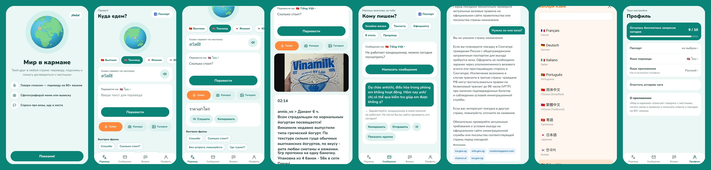

> Исходный код хранится в закрытом репозитории. Здесь витрина проекта: что умеет приложение, как оно устроено и что сделано. Код могу показать по запросу.

---

## Зачем

В другой стране сложно объясниться с таксистом, понять меню или вывеску и быстро узнать, нужна ли виза. Обычный переводчик даёт дословный перевод, а нужен «друг в кармане», который подскажет, как сказать вежливо и что сделать.

## Что умеет

| Функция | Как работает |
|---|---|
| **Перевод текста и голоса** | 62 языка, озвучка перевода, кнопки быстрых фраз («Сколько стоит?», «Где туалет?») |
| **Перевод фото** | меню, вывески, упаковки — фото переводится на язык пользователя |
| **Сообщение местным** | пишет вежливое сообщение хозяйке жилья, таксисту, официанту, в отель или продавцу, с обратным переводом для проверки |
| **Чат-помощник** | визы, транспорт, еда, чаевые; актуальная информация из поиска и ссылки на официальные источники: сайты иммиграционных служб, МИД и посольств |
| **Учёт паспорта** | ответы о визах с учётом гражданства пользователя |
| **«Скажи привет по-местному»** | выбор страны на интерактивной планете |
| **Бесплатный лимит** | 10 запросов в день на устройство, счётчик в профиле |

## Экраны

### Старт и выбор страны

| Приветствие | Главный экран | Выбрана страна: Таиланд |
|---|---|---|
| 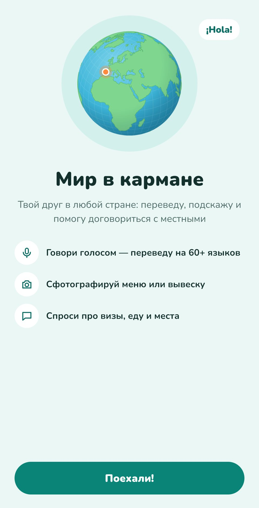 | 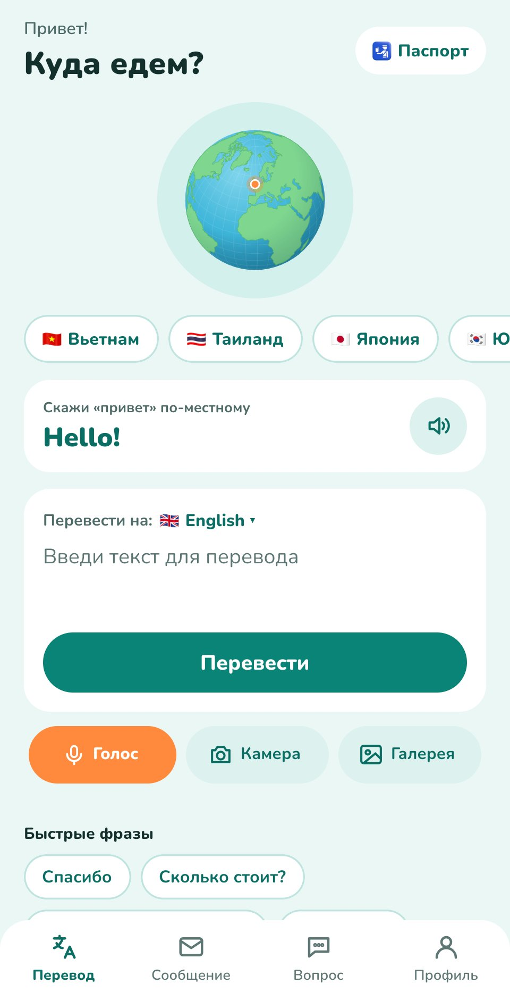 | 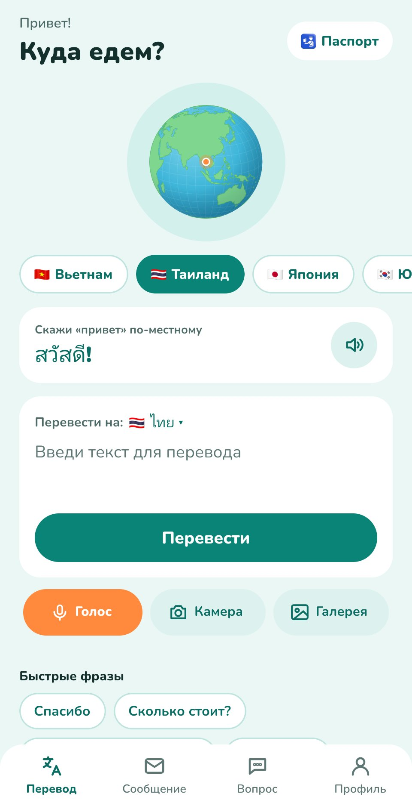 |

Планета поворачивается к выбранной стране, а карточка «Скажи привет по-местному» показывает приветствие на местном языке с озвучкой.

### Перевод

| Текст на тайский | Фото упаковки → русский |
|---|---|
| 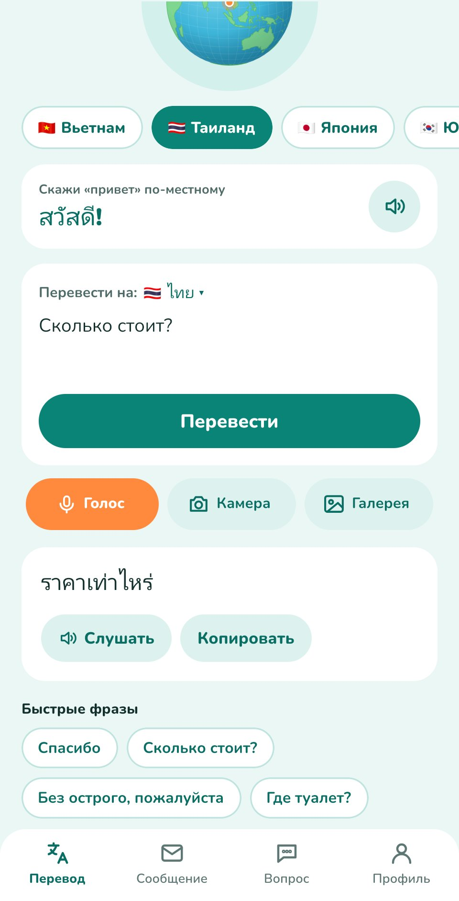 | 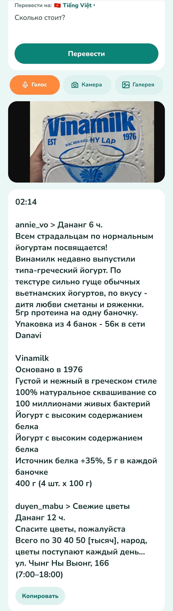 |

### Сообщение местным и вопросы помощнику

| Сообщение хозяйке жилья | Вопрос о визе со ссылками на источники |
|---|---|
| 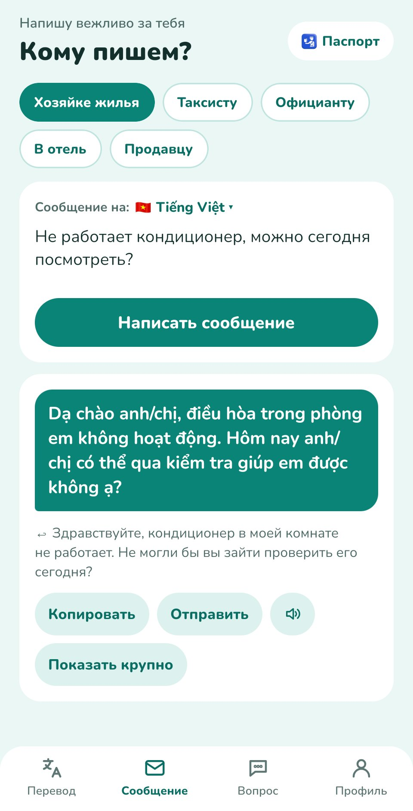 | 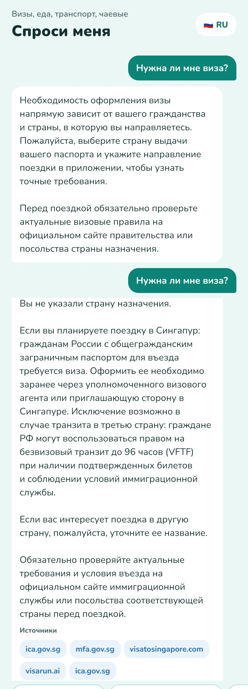 |

**Ответы с источниками.** На вопросы о визах и правилах въезда помощник ищет актуальную информацию и в первую очередь опирается на официальные сайты: иммиграционные службы, министерства иностранных дел, посольства (на скриншоте — `ica.gov.sg`, `mfa.gov.sg`). Ссылки показываются под ответом, чтобы пользователь мог сам проверить правила перед поездкой.

### Языки и профиль

| Список языков | Ещё языки | Профиль и лимит |
|---|---|---|
| 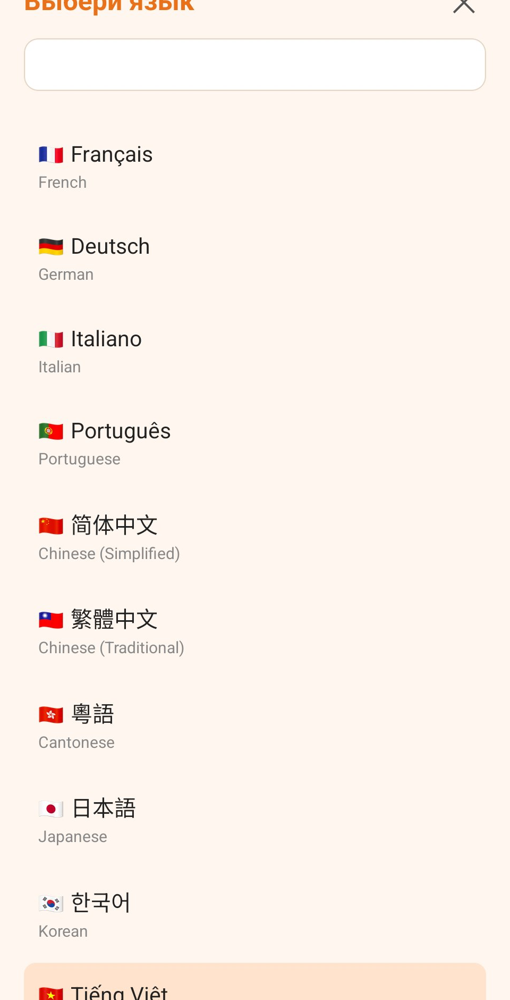 | 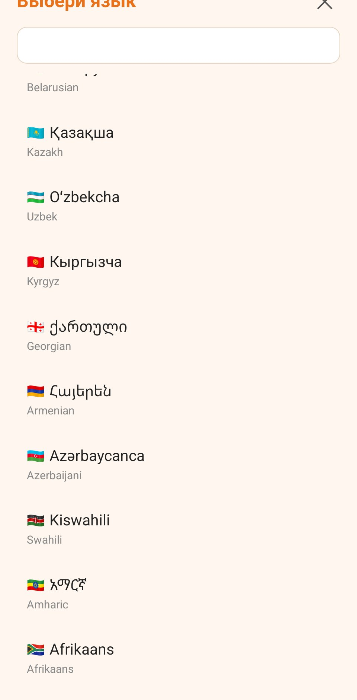 | 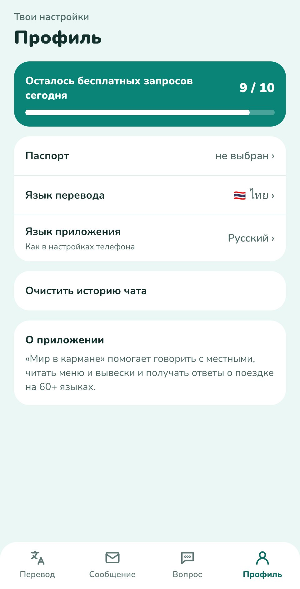 |

## Как устроено

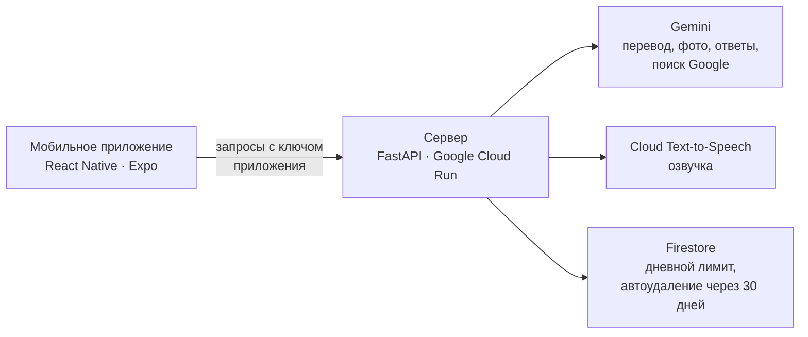

- Ключи ИИ хранятся **только на сервере**, в приложении их нет.
- Сервер принимает запросы только от приложения и ограничивает число бесплатных запросов.
- Аккаунтов нет, личные данные не собираются; история чата хранится на телефоне.
- Есть политика конфиденциальности и условия использования на двух языках.

## Технологии

**Приложение:** React Native, Expo SDK 58, TypeScript, react-native-svg, d3-geo (планета), expo-audio, expo-image-picker, AsyncStorage

**Сервер:** Python, FastAPI, Google Gemini API, Google Cloud Text-to-Speech, Firestore

**Инфраструктура:** Google Cloud Run, EAS Build (сборка APK), бюджет и оповещения о расходах

## Что сделала

- придумала продукт и сценарии: от Telegram-бота к мобильному приложению;
- спроектировала интерфейс и визуальный стиль, нарисовала иконку и заставку;
- собрала приложение на Expo и сервер на FastAPI, подключила ИИ, распознавание и озвучку;
- развернула сервер в облаке, настроила защиту ключей, дневные лимиты и автоудаление данных;
- написала политику конфиденциальности и условия использования;
- собрала Android-версию и провела тестирование на реальном устройстве.

Разработка велась в паре с ИИ-ассистентом: постановка задач, проверка результата, тестирование и доводка — на мне.

## Дальше

- публикация в Google Play;
- Premium-подписка с расширенным лимитом запросов;
- озвучка для оставшихся языков.

---

**Автор:** Ирина Медовникова · связь: worldinpocket.help@gmail.com
